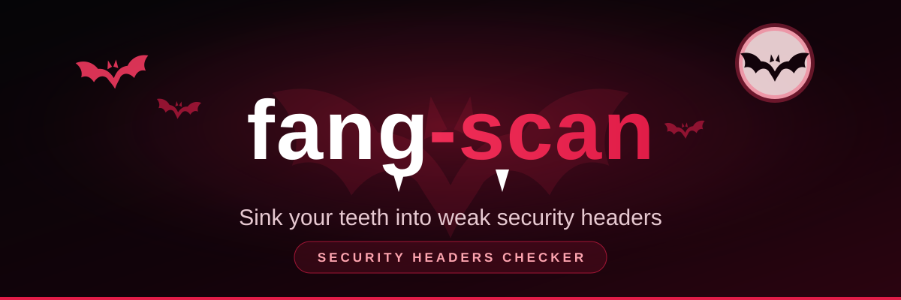

# fang-scan

A security headers checker that grades raw HTTP response headers A–F and tells you exactly how to fix each weakness — entirely in your browser.

## Features

- **Paste-and-audit** — drop in raw response headers (e.g. from `curl -sI`) and get an instant report; no account, no upload, no network calls.
- **10 checks** covering the headers that matter:
  - `Strict-Transport-Security` (presence, `max-age` ≥ 1 year, `includeSubDomains`)
  - `Content-Security-Policy` (flags `unsafe-inline`, `unsafe-eval`, and wildcard sources)
  - `X-Content-Type-Options: nosniff`
  - Clickjacking protection via `X-Frame-Options` or CSP `frame-ancestors`
  - `Referrer-Policy` (flags `unsafe-url`)
  - `Permissions-Policy`
  - `X-XSS-Protection` (warns when the outdated auditor is enabled)
  - Version disclosure via `Server` / `X-Powered-By`
  - `Cache-Control` guidance for sensitive responses
  - `Set-Cookie` flags (`Secure`, `HttpOnly`, `SameSite`) whenever cookies are present
- **Score card** — a weighted 0–100 score with an A–F grade, pass/warn/fail summary, and a severity chip on every finding.
- **Actionable fixes** — each finding explains the risk and shows the exact header to send.
- **Built-in samples** — one click loads a realistic weak header set or a hardened strong set so you can see the difference.
- **Private by design** — everything runs client-side; headers are never uploaded, stored, or sent anywhere. Cookie values are never echoed into the report.

## Usage

Open `index.html` in any modern browser — that's it. No build step and no server required.

**Live demo:** _placeholder — add the hosted URL here once published._

To audit a real site, grab its headers and paste them in:

```bash
curl -sI https://example.com
```

You can also copy response headers from your browser's DevTools (Network tab → document request → Response Headers).

## How it works

1. **Parse** — `parseHeaders` splits the pasted text into header lines, lower-cases names (headers are case-insensitive), keeps duplicates (important for `Set-Cookie`), and skips the status line and malformed lines.
2. **Audit** — `auditHeaders` runs ten independent checks. Each returns a status (`pass`, `warn`, or `fail`), a severity, a plain-language explanation, and a concrete fix.
3. **Score** — checks carry weights (CSP and HSTS weigh most). Pass earns full weight, warn earns half, fail earns none; the total is normalised to 0–100 and mapped to a grade: A ≥ 90, B ≥ 80, C ≥ 70, D ≥ 60, F below that. The cookie check only counts when `Set-Cookie` headers are present.

The auditing logic is pure and exported from `app.js` (`parseHeaders`, `auditHeaders`, `gradeScore`), with the DOM wiring guarded behind `typeof document !== "undefined"` so the same module runs under Node for tests.

## Tests

Requires Node 20+ (no dependencies to install):

```bash
node --test
```

The suite in `tests/headers.test.mjs` covers the parser (case-insensitivity, duplicates, folding), scoring (strong headers score high, missing headers score low), individual checks (CSP `unsafe-inline`, cookie flags, HSTS, framing, referrer, disclosure), and grade boundaries.

## License

MIT — see [LICENSE](LICENSE). Copyright (c) 2026 Lavish Gangwar.
